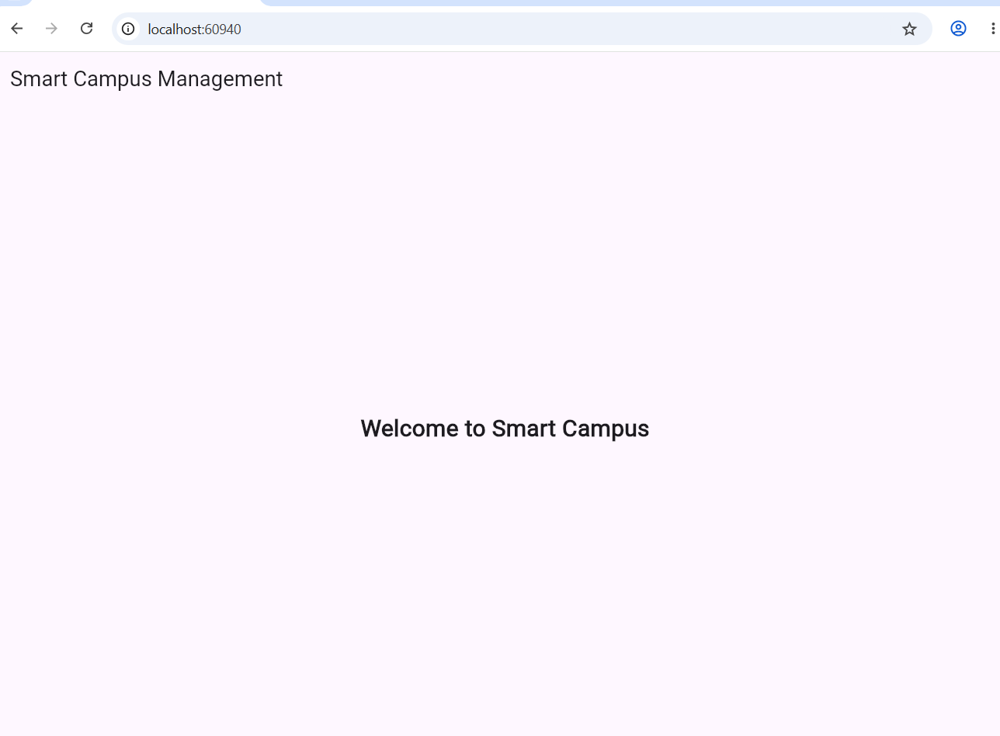
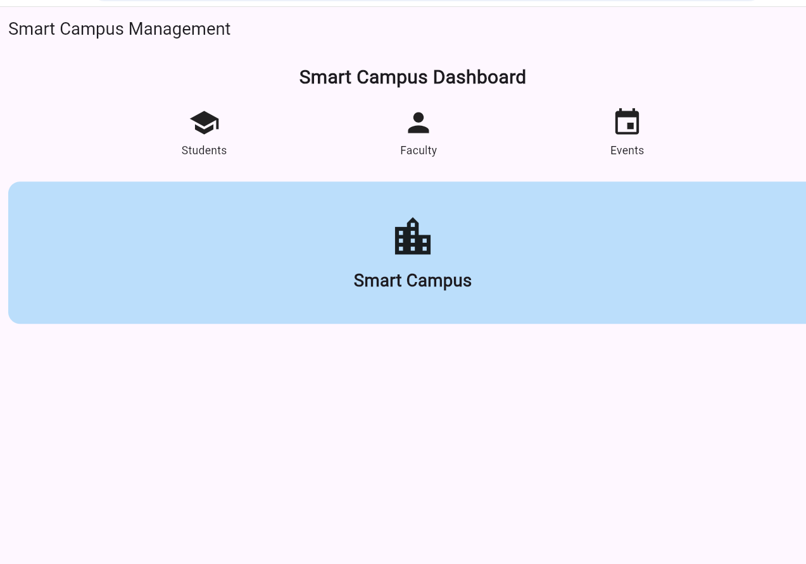
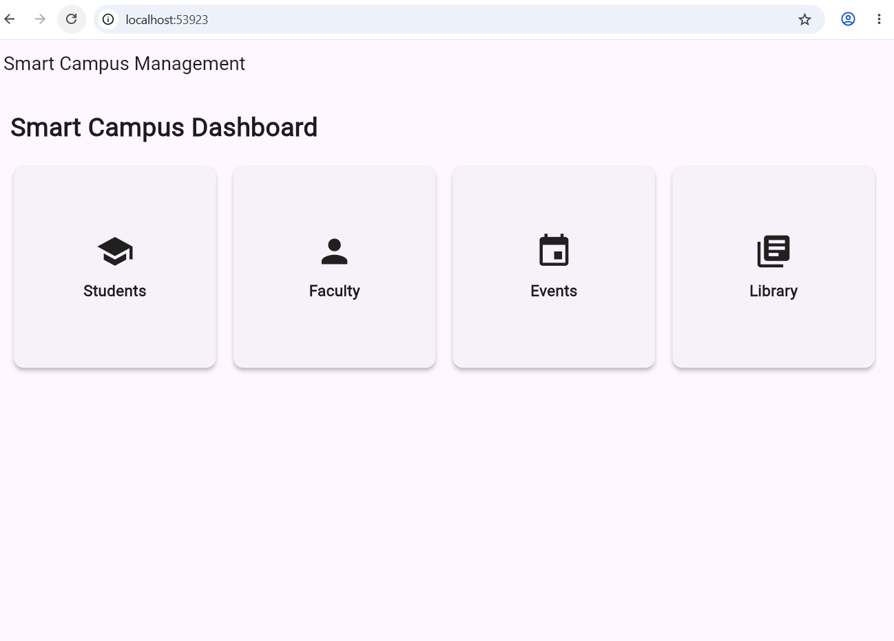
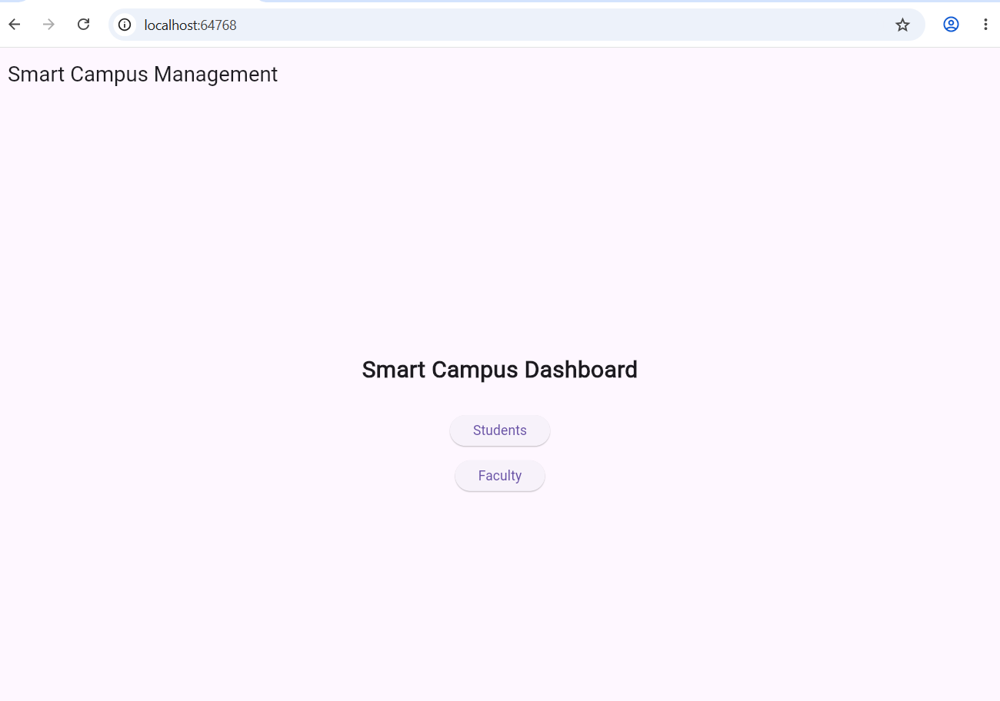
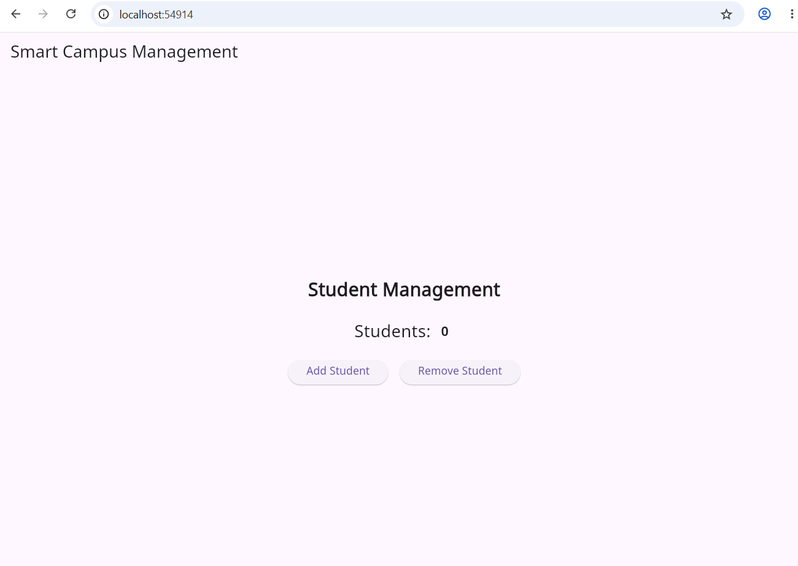
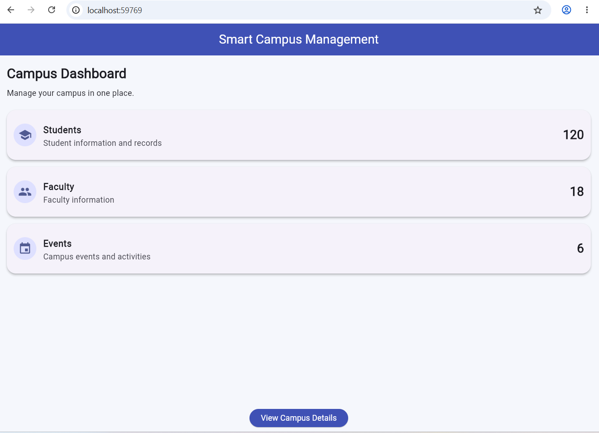
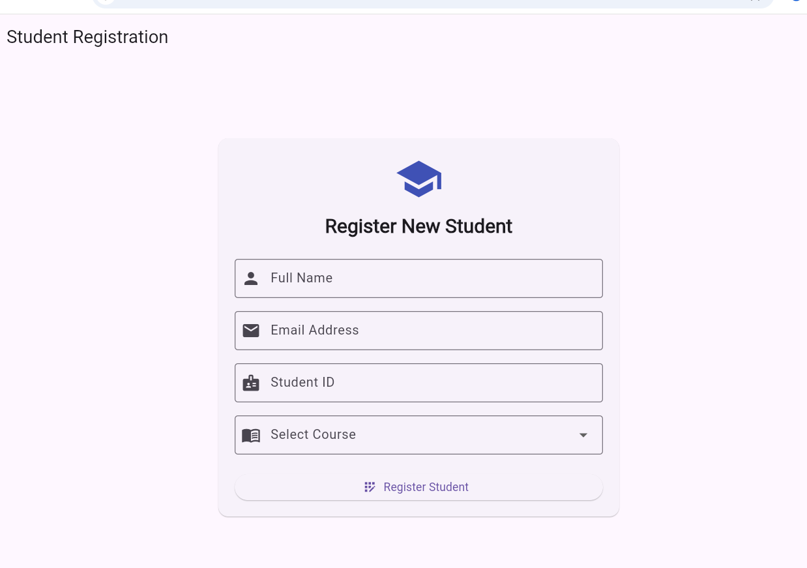
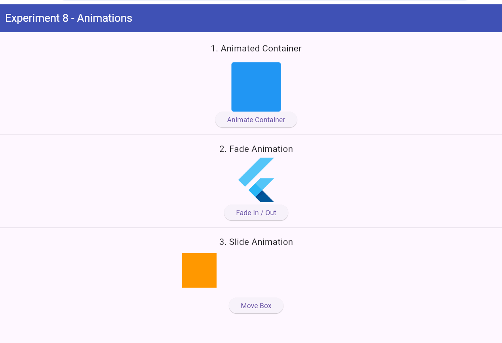
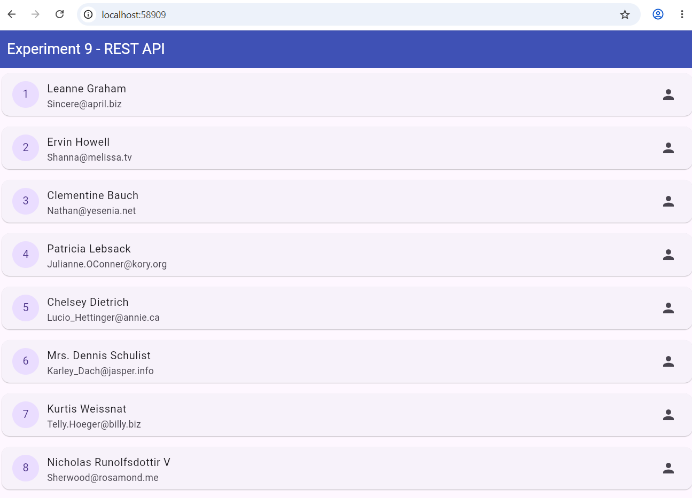

# SmartCampusManagementApp

A Flutter-based Smart Campus Management application developed as part of Flutter lab experiments.

## Features

- Smart Campus welcome screen and dashboard
- Student and faculty navigation
- Campus overview with student, faculty, and event information
- Student management interface
- Student registration form
- UI animations using Flutter
- REST API integration to fetch user details
- Unit testing using Flutter Test

## Technologies Used

- Flutter
- Dart
- HTTP package
- JSONPlaceholder REST API
- Flutter Test

## Experiments and Screenshots

### Experiment 1 – Smart Campus Welcome Screen
Initial welcome screen for the Smart Campus application.



### Experiment 2 – Smart Campus Dashboard
Dashboard showing Students, Faculty, and Events sections.



### Experiment 3 – Dashboard Cards
Dashboard with Students, Faculty, Events, and Library cards.



### Experiment 4 – Dashboard Navigation
Dashboard with navigation options for Students and Faculty.



### Experiment 5 – Student Management
Student management screen with student count and Add Student / Remove Student actions.



### Experiment 6 – Campus Overview Dashboard
Campus overview showing student, faculty, and event counts.



### Experiment 7 – Student Registration Form
Registration form with Full Name, Email Address, Student ID, course selection, and Register Student button.



### Experiment 8 – Flutter UI Animations
Demonstrates AnimatedContainer, fade animation, and slide animation.



### Experiment 9 – REST API Integration
Fetches user details from JSONPlaceholder and displays names and email addresses.



### Experiment 10 – Unit Testing
Created a Calculator class with addition and subtraction methods and tested them using Flutter Test.

**Test result:** `+3: All tests passed!`

> Add your terminal screenshot as `screenshots/experiment10.png` and then add this line below:
> ``

## Getting Started

1. Clone this repository.
2. Open the project folder in Visual Studio Code.
3. Install dependencies:

   ```bash
   flutter pub get
   ```

4. Run the application (for example, Experiment 7):

   ```bash
   flutter run -d chrome -t lib/main.dart
   ```

## Running Tests

```bash
flutter test
```

## Developer

Smart Campus Management App — Flutter Lab Project
